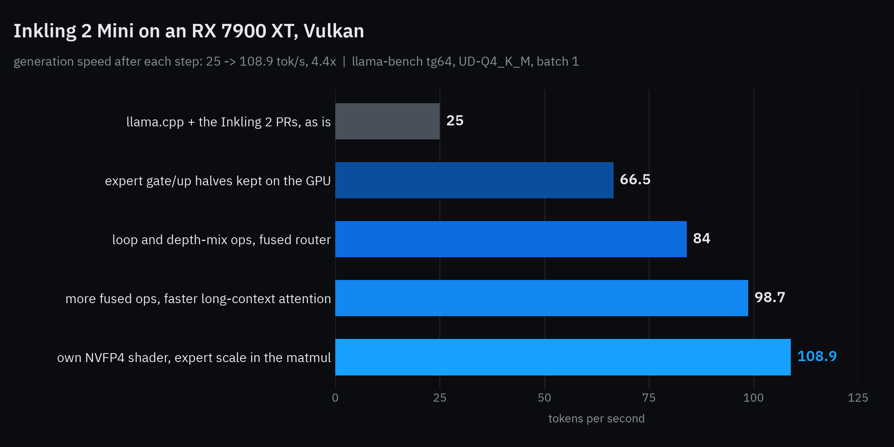
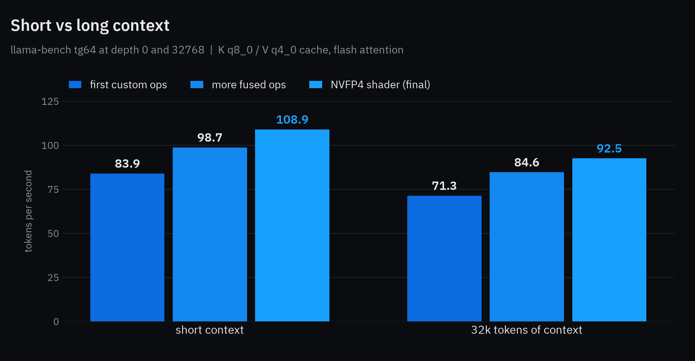

# Inkling 2 Mini on Vulkan

This llama.cpp branch runs Thinking Machines' Inkling 2 Mini (26B MoE, 3.4B active, middle layers looped 3x) fast through the Vulkan backend. Built and measured on one RX 7900 XT (20 GB, Mesa RADV, Linux).

## Speed



Generation at batch 1, llama-bench tg64, Inkling-2-Mini-UD-Q4_K_M:

| Step | tok/s |
|---|---:|
| llama.cpp + the Inkling 2 PRs (#32695, #32218), as is | 25 |
| expert gate/up views kept on the GPU (SCALE through strides) | 66.5 |
| clip as l2_norm, 1000-node submits, router fused (TOPK_MOE) | 72.5 |
| DEPTH_MIX op (the depth mix in 1 op instead of ~9) | 77.1 |
| short-conv residual folded into the conv weights | 80.8 |
| LOOP_GATE op (the loop controller in 1 op) | 84.0 |
| SITU, CLIP_NORM, CONV_STEP, LOOP_DOWN ops, REL_MASK with sinks, grouped-query flash attention for per-head masks | 98.7 |
| NVFP4 mat-vec shader, expert scale fused into the matmul, faster DEPTH_MIX / LOOP kernels, early first submit | 108.9 |

Rows up to 84.0 use llama-bench's default f16 cache; the last two use K q8_0 / V q4_0 as in daily use (the 84.0 build gives 83.9 that way).

Through llama-server, short replies, at the 84.0 / 98.7 / 108.9 steps: 81 -> 97 -> 108 tok/s.

At 32k context (tg64 at depth 32768): 71.3 -> 92.5 tok/s. Prompt processing: pp512 2075 tok/s.



Long chats: the upstream graph builds the relative-position bias as a dense F32 [n_head, n_kv, n_tokens] tensor (3 GB at 64k), so prompt reading fell off a cliff at ~12k tokens. REL_MASK builds an F16 mask + bias straight from the table: a 75k-token chat is read at ~840 tok/s on average.

Quality: KLD vs the CPU backend 0.0040 (run-to-run noise ~0.0006); wikitext-2 perplexity (ctx 512) 7.67, in line with the 7.65-7.69 reported upstream.

Where the ~9.2 ms per token go now: experts ~3.1 ms (memory-bound, ~600 of ~800 GB/s), ~27 dependent steps per layer pass x 48 passes at ~1-1.5 us each, attention ~8 us per pass at short context, LM head 0.6 ms.

## Build

```
cmake -B build -DGGML_VULKAN=ON -DCMAKE_BUILD_TYPE=Release
cmake --build build -j
```

Same requirements as any llama.cpp Vulkan build (Vulkan headers and loader, glslc).

## Run

Model: `Inkling-2-Mini-UD-Q4_K_M.gguf` from https://huggingface.co/unsloth/Inkling-2-Mini-GGUF (the file at the top level; the `Mainline_Support` files are for upstream's newer layout).

```
GGML_VK_SUBALLOCATION_BLOCK_SIZE=4000000000 ./build/bin/llama-server \
  -m Inkling-2-Mini-UD-Q4_K_M.gguf -ngl 99 -c 98304 -np 1 -fa on -ctk q8_0 -ctv q4_0 \
  --jinja --temp 1.0 --top-p 1.0 --top-k 40 --min-p 0
```

- 96k context with K q8_0 / V q4_0 takes ~19.5 GB of VRAM on a 20 GB card with a desktop running.
- `GGML_VK_SUBALLOCATION_BLOCK_SIZE` keeps the compute buffer in one piece. Without it the buffer is re-made around 63k tokens and, with VRAM nearly full, the driver puts it in system RAM (prompt reading ~20x slower).
- `--top-k 40`: sampling the full 201k vocabulary (top-k 0, the GGUF default) costs ~1 ms per token on the CPU.
- `LLAMA_IMAGE_AS_TEXT=1` turns images in a request into a short text note (for agent harnesses that send screenshots to this text-only model).

## Checking it

Every new op has a CPU version and test-backend-ops cases:

```
./build/bin/test-backend-ops -o DEPTH_MIX    # also LOOP_GATE, LOOP_DOWN, REL_MASK, CLIP_NORM, CONV_STEP, MUL_MAT_ID_SCALED
```

Each change can be switched off to compare (set to 1): `INK_OLD_NVFP4`, `INK_NO_SCALE_ID`, `INK_OLD_MIX`, `INK_OLD_CTL`, `INK_OLD_SITU`, `INK_OLD_SINK`, `INK_OLD_CLIP`, `INK_OLD_CONV`, `INK_OLD_DOWN`, `INK_OLD_REL`, `INK_NO_MASK_HEADS_GQA`, `INK_NO_CONV_FOLD`; `INK_FIRST_SUBMIT=0`.

## Base and limits

- llama.cpp b12591 (2026-11-20) + PR #32695 (looped layers) + PR #32218 (DSpark draft model). The commit messages list each change with its gain.
- Tuned on one GPU (RX 7900 XT, RDNA3). The shaders are plain GLSL and pass the tests, but other cards are untested.
- The DSpark draft model runs (38-48 tok/s) but is slower than plain decoding here.
- Vision (mmproj) not tried.
- Upstream merged its own looped Inkling 2 support on 2026-11-21 (#32704) with a different GGUF layout; this branch predates it and runs the original file.
